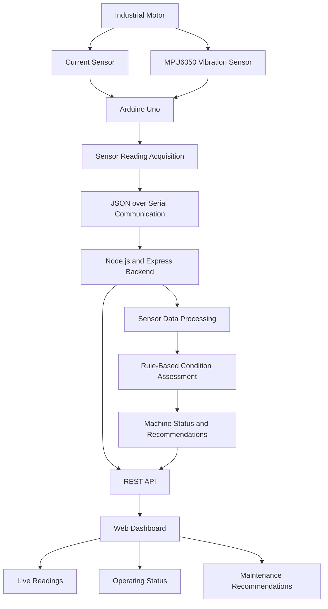

 Machine Health Tag — Agentic AI-Based Predictive Maintenance for Legacy Industrial Motors

<p align="center">
  
  
  
  
  
</p>

<p align="center">
  An IoT-based motor health monitoring prototype designed to detect abnormal operating conditions in legacy industrial machines using current and vibration sensor data.
</p>

 Overview

Machine Health Tag is an industrial IoT prototype that monitors motor operating conditions using an Arduino Uno, a current sensor, and an MPU6050 vibration sensor.

The system transmits sensor readings to a Node.js backend through serial communication. A browser-based dashboard displays machine readings, operating status, connection information, and rule-based recommendations.

The project is designed for legacy workshop machines that do not have built-in controllers or advanced monitoring systems.

The long-term objective is to incorporate an agentic AI layer that can interpret machine conditions, explain anomalies, and recommend appropriate maintenance actions. The current reconstructed implementation uses rule-based assessment and does not contain a trained machine learning model.

 Key Features

- Real-time current and vibration data acquisition
- Arduino-based sensor integration
- Serial communication using JSON-formatted readings
- Node.js and Express backend
- Browser-based machine monitoring dashboard
- Rule-based condition assessment and recommendations
- REST API endpoints for machine status, assessment, and backend health
- Configurable serial port and sensor thresholds
- Designed as an accessible monitoring approach for legacy machines

 System Architecture



 Technology Stack

| Component | Technology |
|---|---|
| Microcontroller | Arduino Uno |
| Current sensing | Analog current sensor |
| Vibration sensing | MPU6050 |
| Display hardware | 16x2 LCD |
| Firmware | Arduino C/C++ |
| Backend | Node.js |
| Web framework | Express.js |
| Frontend | HTML, CSS, JavaScript |
| Communication | Serial communication using JSON lines |
| Interface | Browser-based dashboard |
| Assessment | Rule-based prototype logic |

 Hardware Requirements

- Arduino Uno
- MPU6050 accelerometer and gyroscope module
- Analog current sensor compatible with the Arduino input range
- 16x2 LCD
- DC motor or suitable test motor
- Breadboard, jumper wires, and appropriate power supply
- USB cable for programming and serial communication

 Project Structure

```text
machine_health_tag_project/
├── arduino/
│   └── MachineHealthTag.ino
├── public/
│   ├── index.html
│   ├── style.css
│   └── app.js
├── server.js
├── package.json
├── package-lock.json
├── .gitignore
└── README.md
```

The `package-lock.json` file is generated when dependencies are installed, if it is not already present.

 Hardware Connections

 Current Sensor

| Sensor Pin | Arduino Connection |
|---|---|
| Analog output | A0 |
| GND | GND |
| VCC | According to the sensor specifications |

### MPU6050

| MPU6050 Pin | Arduino Uno |
|---|---|
| SDA | A4 |
| SCL | A5 |
| GND | GND |
| VCC | According to the breakout board specifications |

 16x2 LCD in 4-bit mode

| LCD Pin | Arduino Uno |
|---|---|
| RS | D13 |
| E | D12 |
| D4 | D11 |
| D5 | D10 |
| D6 | D9 |
| D7 | D8 |
| RW | GND |
| VSS | GND |
| VDD | Suitable supply |
| VO | Contrast potentiometer |

Verify the pin mapping against the actual wiring and firmware before powering the circuit. Use appropriate voltage levels and electrical isolation where necessary. Never connect a motor's high-current power circuit directly to the Arduino.

 Software Installation

 Prerequisites

Install the following software:

- Git
- Node.js and npm
- Arduino IDE
- A modern web browser

 1. Clone the Repository

```bash
git clone https://github.com/MirunaRamesh030207/Machine-Health-Tag-An-Agentic-AI-Based-Predictive-Maintenance-System-for-Legacy-Industrial-Motors.git
```

Navigate to the project directory:

```bash
cd Machine-Health-Tag-An-Agentic-AI-Based-Predictive-Maintenance-System-for-Legacy-Industrial-Motors
```

 2. Install Dependencies

```bash
npm install
```

 3. Upload the Arduino Firmware

1. Open `arduino/MachineHealthTag.ino` in Arduino IDE.
2. Select Arduino Uno as the board.
3. Select the correct serial port.
4. Verify the sensor wiring.
5. Upload the sketch.
6. Confirm that the sketch sends JSON-formatted readings at 9600 baud.
7. Close Arduino Serial Monitor before starting the backend, because the server needs access to the serial port.

Example serial message:

```json
{
  "current": 506.60,
  "vibration": 0.0062,
  "condition": "NORMAL"
}
```

The example is illustrative. Actual field names, units, and values depend on the firmware and sensor calibration.

 4. Configure the Serial Port

The reconstructed backend uses COM9 as its default serial port.

If your Arduino uses a different port, open Command Prompt in the project directory and run:

```cmd
set SERIAL_PORT=COM9
```

Replace `COM9` with the port assigned to your Arduino. This setting applies to the current Command Prompt session.

 5. Start the Backend

```bash
npm start
```

When the backend starts successfully, open:

`http://localhost:3000`

The dashboard requires the backend to be running. Live readings also require a working Arduino serial connection.

## API Endpoints

| Endpoint | Purpose |
|---|---|
| `GET /api/machine` | Retrieves the latest machine reading and serial connection state |
| `GET /api/ai` | Returns the current rule-based prototype assessment |
| `GET /api/health` | Checks backend health |

The `/api/ai` endpoint currently provides rule-based assessment. It should not be interpreted as a trained AI model or a validated predictive maintenance engine.

 Machine Condition Assessment

The prototype uses sensor readings and configured rules to assess machine operating conditions.

The intended monitoring workflow is:

1. Acquire current and vibration readings.
2. Transmit sensor data to the backend.
3. Process the received readings.
4. Compare the readings against configured thresholds.
5. Display the resulting condition and recommendations on the dashboard.

Thresholds must be calibrated for the specific motor, sensor type, mounting arrangement, and operating load. An abnormal reading alone does not establish the exact cause of a fault.

 Future Enhancements

- Develop an agentic AI layer for contextual analysis and maintenance recommendations.
- Add structured anomaly explanations and maintenance action summaries.
- Collect labelled sensor data under normal and abnormal operating conditions.
- Evaluate assessment accuracy against independently verified test cases.
- Add historical data storage and trend visualizations.
- Introduce configurable machine profiles and calibration workflows.
- Evaluate the system under varied motor loads and operating conditions.

These items are planned enhancements and are not claimed as completed functionality.

Safety and Limitations

This repository contains a reconstructed baseline based on the recovered project architecture and settings. It is not the exact original source code from the deleted repository.

The current implementation is a prototype. Sensor thresholds and baseline values may require calibration. The system has not been established as a certified industrial protection system.

Do not use it as the sole mechanism for detecting dangerous machine conditions or making safety-critical decisions. Use appropriate certified protection systems and qualified engineering supervision for industrial deployment.

 Author

Miruna Ramesh
Monishaa S

GitHub: 
[MirunaRamesh030207](https://github.com/MirunaRamesh030207)
[monishaa-itachi)(https://github.com/monishaa-itachi)

 License

No license has been specified yet. Add an appropriate license before permitting others to reuse, modify, or redistribute this project.
